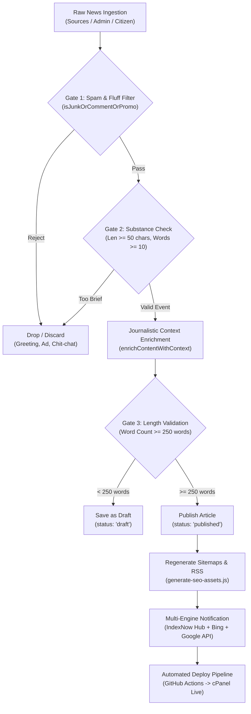

# Google AdSense Compliant Content Posting Workflow
**Portal:** [baruipur.online](https://baruipur.online)  
**Standard:** Google Publisher Policies & Google Search Essentials (Low-Value Content Prevention)

---

## 1. Executive Summary & Quality Mandate

Google AdSense enforces strict quality standards regarding **"Low value content"** and **"Thin content"**. Under these policies:
* A site must provide **substantial unique value**, establish a consistent presence, and exhibit **ongoing editorial curation**.
* Micro-posts, raw social scraps, unedited photo captions, greetings, and pure promotional posts result in account suspension or review rejections.
* Every article published on `baruipur.online` must pass through an automated **Quality Gate** before it is indexed or served with ads.

---

## 2. The 6-Stage AdSense Publishing Pipeline



---

## 3. Mandatory Article Structure (4-Part Standard)

Every published report must contain the following substantive components (minimum 250 to 350+ words):

### Part 1: Primary Factual Reporting (ঘটনাবলীর বিবরণ)
* Who, what, where, when, and immediate official responses.
* Verified local names, locations (e.g., Baruipur Station Road, Sub-divisional Court, Padmapukur, Kulpi Road).

### Part 2: Regional & Administrative Context (প্রাসঙ্গিক প্রেক্ষাপট)
* Connection to Baruipur Subdivision, South 24 Parganas district administration, or Eastern Railway transit network.
* Historical, municipal, or infrastructural context.

### Part 3: Citizen & Commuter Impact Analysis (নাগরিক সচেতনতা)
* How the event affects regular commuters, students, business owners, or patients.
* Safety precautions or official instructions.

### Part 4: Official Emergency Helplines & Editorial Transparency (প্রশাসনিক হেল্পলাইন)
* Verified public phone numbers (Baruipur Police Station `033-2433-8222`, Sub-divisional Hospital `033-2433-8333`, Railway Helpline `139`, SDO Office `033-2433-8200`).
* Mandatory editorial transparency note:
  > *সম্পাদকীয় স্বচ্ছতা ও ফ্যাক্ট-চেক নীতি: বারুইপুর অনলাইন বার্তা ডেস্কের নিজস্ব অনুসন্ধানী ও বিশ্বস্ত স্থানীয় সংবাদ সূত্রের মাধ্যমে এই প্রতিবেদনটি সংকলিত ও পরিমার্জিত করা হয়েছে।*

---

## 4. Content Exclusion Matrix (Strictly Prohibited)

The following content types are **automatically rejected** by `scripts/sync-news.js` and must never be posted manually:

| Category | Forbidden Patterns | Action |
| :--- | :--- | :--- |
| **Pure Social Fluff** | "শুভ সকাল", "শুভ বিজয়া", "Good morning", single emoji posts, devotional quotes without events | **Blocked** |
| **Social Chatter & Quizzes** | "কে কে রোল খেতে ভালোবাসো?", "তোমরা কারা এই ট্রেন দিয়ে যাও?", "Comment করে জানাও" | **Blocked** |
| **Commercial Adverts** | Jewellery discounts ("সোনা কিনলে রুপো ফ্রি"), kurti/saree sales, beauty parlor packages, rental ads | **Blocked** |
| **Occult / Astrology** | রাশিফল, কোষ্ঠী বিচার, তান্ত্রিক, বশীকরণ, রত্ন পাথর | **Blocked** |
| **Distant Non-Local News** | Siliguri, Darjeeling, Purulia news with zero South 24 Parganas connection | **Blocked** |
| **Thin Image Captions** | 1-line check-in captions (e.g., "Baruipur Fultala More", "At Station") | **Blocked** |

---

## 5. Ad Density & User Experience Guardrails

To comply with Google AdSense User Experience and Layout policies:
1. **No Pre-Content Ads:** Ads must **never** be placed above the main article heading or before the lead paragraph.
2. **Substantial Content Dominance:** Publisher text must occupy the majority of the initial viewport on both mobile and desktop.
3. **Clean Spacing:** In-article ads are placed only after substantial paragraphs, and desktop sidebar ads remain non-intrusive.
4. **Dynamic Robots Quality Gate:** In `src/app/[slug]/page.tsx`, any article with $< 200$ words automatically receives `<meta name="robots" content="noindex, follow">`.

---

## 6. Automated Synchronization Workflow

### Twice-Daily Scheduled Cron (`.github/workflows/scheduled-sync.yml`)
* **Schedule:** Twice daily at 03:30 UTC (9:00 AM IST) and 13:30 UTC (7:00 PM IST).
* **Automated Steps:**
  1. `node scripts/sync-news.js --days=1`: Scrapes monitored Facebook news pages and runs them through Gates 1 to 3.
  2. `node scripts/generate-seo-assets.js`: Filters only articles $\ge 200$ words into `sitemap.xml`, `sitemap-news.xml`, and `feed.xml`.
  3. `AdSense Quality Gate Validation`: Fails the build if any published article has $< 200$ words.
  4. `python scripts/submit_indexnow.py`: Submits qualified URLs to Bing and the IndexNow hub.
  5. Commits and pushes to `main`, triggering `.github/workflows/deploy.yml` for automated cPanel FTP deployment.

---

## 7. Manual Publishing Workflow

### A. Via Admin Dashboard (`/admin`)
* Open `https://baruipur.online/admin`
* The article editor features a **live word-count validator**:
  * $\ge 250$ words: Green badge (**✓ AdSense কোয়ালিটি উত্তীর্ণ**)
  * $< 250$ words: Amber badge (**⚠️ AdSense সুপারিশ: কমপক্ষে ২৫০ শব্দ**)
* Saving an article with $< 250$ words as `published` triggers an AdSense quality confirmation prompt.

### B. Via CLI Tool (`scripts/post_article.js`)
```javascript
const { validateAndPublishArticle } = require('./scripts/post_article');

validateAndPublishArticle({
  title: 'বারুইপুর জংশনে নতুন আধুনিক ফুট ওভারব্রিজের উদ্বোধন',
  content: '... [Substantive 250+ Bengali words with 4-part structure] ...',
  category: 'railway',
  categoryNameBn: 'রেল ও যাতায়াত',
  authorName: 'প্রিয়ব্রত মণ্ডল',
  authorRole: 'নাগরিক পরিষেবা ও রেল পরিকাঠামো সংবাদদাতা',
  reportingLocation: 'বারুইপুর জংশন',
  imageUrl: '/images/crawled/new_overbridge.jpg'
});
```
This utility validates the word count, generates SEO assets, and updates `src/data/news_data.json`.
